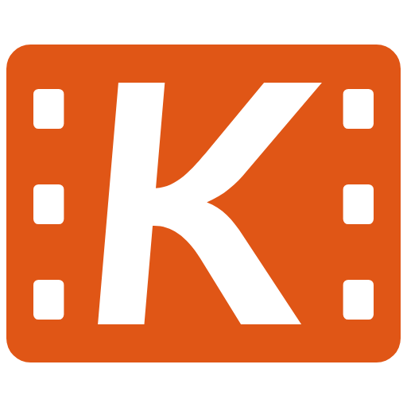

  

# Koteyye Media Studio v2

[English version](README.md)

Koteyye Media Studio — настольное приложение для работы с ИИ-моделями
**Cheaper Inference** и **OpenRouter**. В одной студии можно генерировать
изображения, видео, речь, музыку и звуковые эффекты, а результаты сохранять
локально. Можно подключить оба сервиса и выбирать нужного провайдера в студии.

Добавь ключи API в разделе **Настройки → Подключение**. Набор моделей зависит
от выбранного провайдера.

## Подключение агента через MCP

Включи локальный сервер в разделе **Настройки → MCP** и скопируй промпт
подключения в среду разработки агентов (ADE). Агент сможет просматривать
каталог, запускать генерацию и получать готовые файлы через студию.

Сервер доступен по адресу `http://127.0.0.1:29731/mcp`. В промпте есть инструкции
для клиентов Streamable HTTP и stdio. Храни токен MCP в секрете, поскольку он
даёт доступ к генерации, в том числе к платным запросам.

## Запуск из исходников

Установи Rust stable с целью `wasm32-unknown-unknown`, Tauri CLI 2 и Dioxus CLI
0.7.10. Запусти `cargo tauri dev` из корня репозитория.
